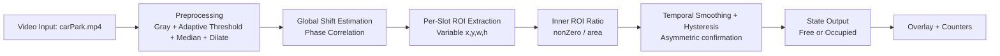
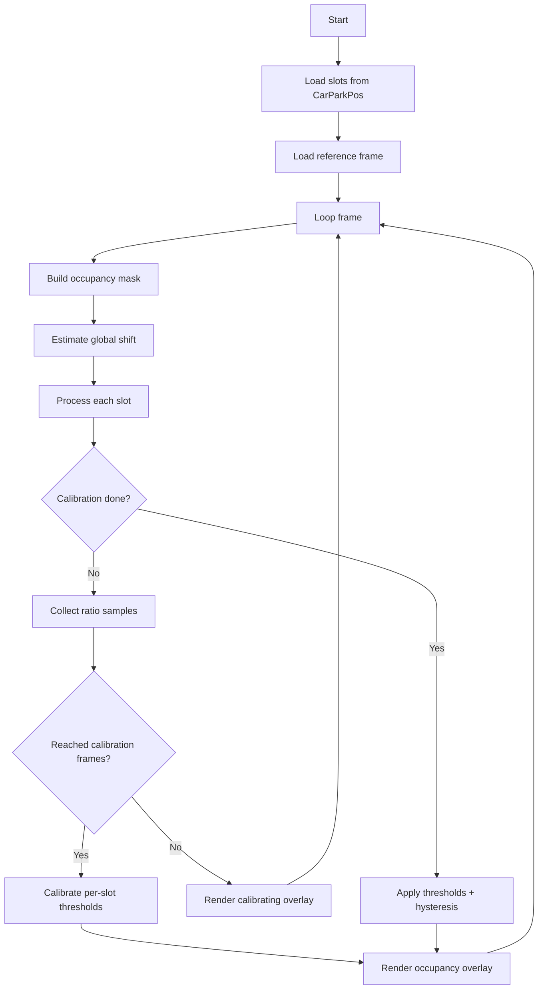
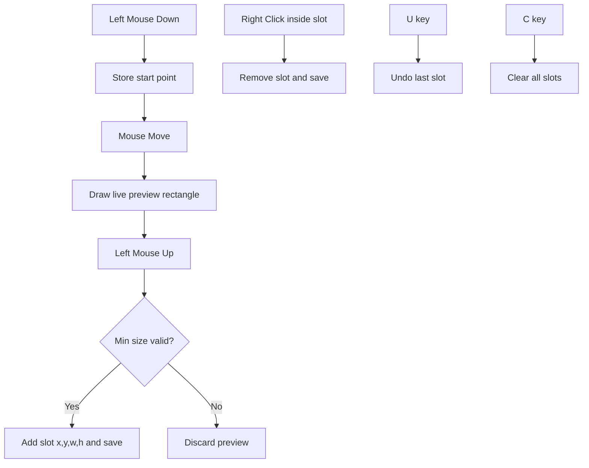
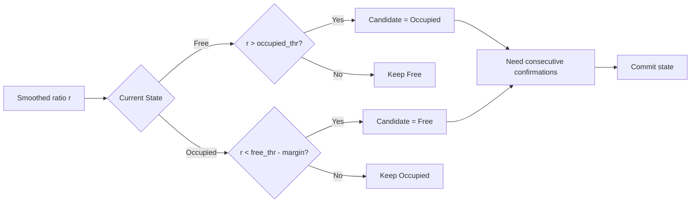
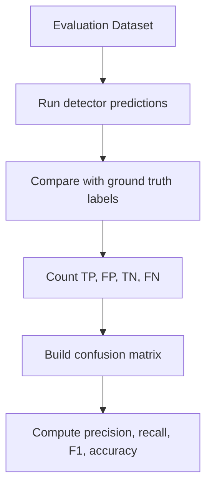
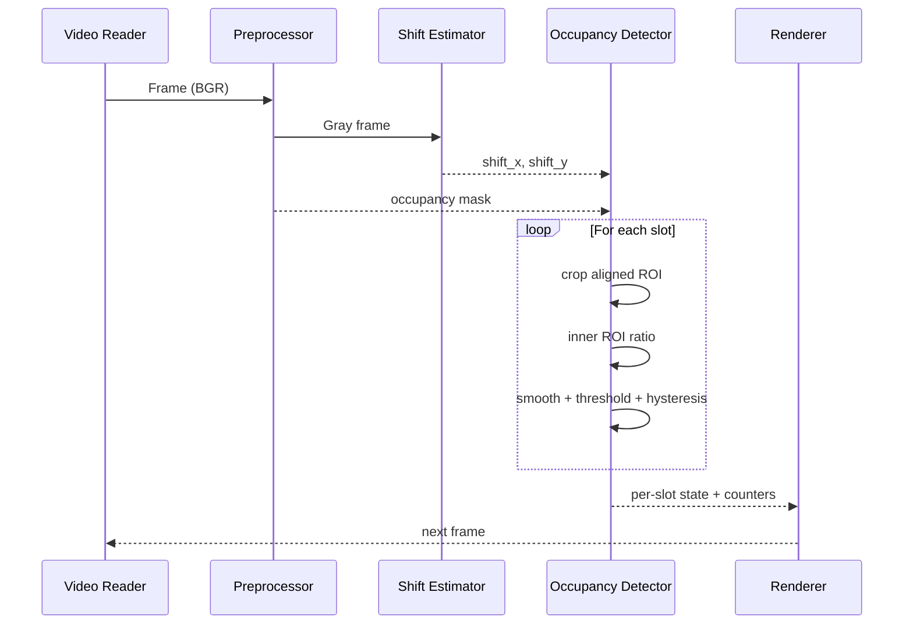

# Smart Parking Occupancy Detection (Variable-Size Slots)

This project detects parking occupancy from video using OpenCV with robust, per-slot adaptive thresholding. It supports variable slot sizes using click-drag marking and a modular codebase designed for tuning and extension.

## 1. Highlights

1. Variable-size parking slot marking with click-drag.
2. Move, resize, duplicate, zoom, and pan support in the slot editor.
3. Polygon parking slots for angled spaces.
4. Automatic legacy slot migration from fixed `(x, y)` points to rectangular slots `(x, y, w, h)`.
5. Global frame-shift compensation for slight camera jitter.
6. Per-slot auto-calibration with clustering-based threshold discovery.
7. Optional YOLO vehicle fallback for difficult lighting and camera angles.
8. Modular architecture for maintainability.

## 2. Project Structure

```text
.
   |-- main.py
   |-- ParkingSpacePicker.py
   |-- CarParkPos
   |-- config.json
   |-- requirements.txt
   |-- requirements-ml.txt
   |-- pyproject.toml
   |-- carPark.mp4
   |-- carParkImg.png
`-- parking/
   |-- __init__.py
   |-- config.py
   |-- slot_io.py
   |-- preprocess.py
   |-- alignment.py
   |-- detector.py
   `-- ml_fallback.py
```

## 3. System Architecture



## 4. End-to-End Detection Flow



## 5. Slot Marking Workflow (Click-Drag)



## 6. Module Responsibilities

1. `parking/config.py`
2. Centralized detector and tracking parameters.

3. `parking/slot_io.py`
4. Slot load/save, legacy migration, geometry helpers.

5. `parking/preprocess.py`
6. Frame preprocessing to occupancy mask.

7. `parking/alignment.py`
8. Frame-to-reference translation estimation.

9. `parking/detector.py`
10. Per-slot calibration, state machine, visualization overlays.

11. `ParkingSpacePicker.py`
12. Interactive editor for variable-size slot annotation.

13. `main.py`
14. Thin runtime orchestrator using modules.

## 7. Thresholding Strategy

### 7.1 Ratio-Based Occupancy Metric

For each slot, occupancy uses normalized ratio:

$$
ratio = \frac{\text{countNonZero}(innerROI)}{\text{area}(innerROI)}
$$

This makes slots of different sizes comparable.

### 7.2 Auto-Calibration

1. During warm-up frames, each slot collects `ratio` samples.
2. K-means with `k=2` estimates low/high clusters for free/occupied behavior.
3. If slot-level clusters are weak, global pooled fallback is used.
4. Threshold pair (`free`, `occupied`) is generated per slot.

### 7.3 Decision Hysteresis

1. If currently free, switch to occupied only when ratio crosses occupied threshold.
2. If currently occupied, switch to free only when ratio is below free threshold minus margin.
3. State changes require consecutive-frame confirmation:
4. free->occupied: faster.
5. occupied->free: slower.



## 8. Confusion Matrix Template

Use this to evaluate field performance after labeling sample frames:

| Actual \\ Predicted | Free | Occupied |
|---|---:|---:|
| Free | TP_free | FN_free |
| Occupied | FP_free | TP_occ |

Derived metrics:

$$
Precision_{free} = \frac{TP_{free}}{TP_{free} + FP_{free}}
$$

$$
Recall_{free} = \frac{TP_{free}}{TP_{free} + FN_{free}}
$$

$$
Accuracy = \frac{TP_{free} + TP_{occ}}{Total}
$$

### Visual Confusion Matrix Sketch



## 9. Installation

1. Create or activate your Python environment.
2. Install dependencies:

```bash
pip install opencv-python numpy cvzone
```

For optional YOLO fallback:

```bash
pip install -r requirements-ml.txt
```

## 10. Usage

### 10.1 Annotate Slots

```bash
python ParkingSpacePicker.py
```

Controls:

1. `R`: rectangle mode.
2. `P`: polygon mode.
3. Left mouse drag on empty area: create rectangle.
4. Left mouse click inside a slot: select and move.
5. Drag yellow handles: resize rectangle corners or polygon vertices.
6. `D`: duplicate selected slot.
7. Mouse wheel: zoom.
8. Middle mouse drag: pan.
9. Right mouse click inside slot: remove slot.
10. In polygon mode, left click adds points and `Enter` saves the polygon.
11. `U`: undo last slot.
12. `C`: clear all slots.
13. `Q`: quit.

### 10.2 Run Detection

```bash
python main.py
```

1. Let calibration complete during startup.
2. Press `Q` to quit.

## 11. Data Format

Slots are stored in `CarParkPos` as a pickled list of dict items:

```python
{"id": 1, "type": "rect", "x": 300, "y": 420, "w": 88, "h": 40}
```

Polygon slots use:

```python
{"id": 2, "type": "polygon", "points": [(300, 420), (388, 416), (392, 456), (304, 460)]}
```

Legacy entries like `(x, y)` are auto-migrated using default width/height and saved back in new format.

## 11.1 Configuration

Runtime parameters live in `config.json`. Set `use_ml_fallback` to `true` to enable YOLO-based vehicle assistance after installing `requirements-ml.txt`.

## 12. Processing and Detection Diagram (Detailed)



## 13. Tuning Guide

Tune values in `parking/config.py`:

1. `calibration_frames`: increase for more stable threshold learning.
2. `inner_margin_x_ratio`, `inner_margin_y_ratio`: increase to ignore boundary noise.
3. `occupied_to_free_confirm_frames`: increase if parked cars still flip to free.
4. `free_release_margin_ratio`: increase to make free decision more conservative.
5. `max_shift_pixels`: lower if offset correction is too aggressive.

## 14. Future Improvements

1. Polygon slot support instead of rectangles.
2. Persistent threshold cache for instant startup.
3. Uncertain state (amber) for low-confidence frames.
4. Per-slot reliability scoring and auto-alert for unstable slots.
5. Optional ML classifier fallback for difficult slots.

## 15. Credits

Original inspiration: Computer Vision Zone parking detection concept.
